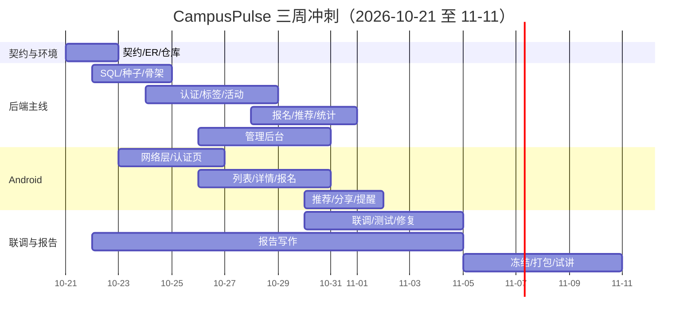

# CampusPulse 三周冲刺计划（v2.1）

| 项目 | 内容 |
|---|---|
| 课题 | 基于安卓的个性化校园活动推荐平台（CampusPulse） |
| 角色 | 成员 B，服务端主负责人，工作量 50% |
| 版本 | v2.1（报告口径修订） |
| 日期 | 2026-10-21（第 6 周周三） |
| 提交假设 | 2026-11-11（第 9 周周三）提交，11-11 至 11-15 答辩 |
| 依据 | 成员 A 反馈：提交答辩在 3–4 周后，可能在第九周；报告仅 1 份、正文 7500 字，进度紧张时可压缩；允许新增 `docs/` 但需 Review；Android 业务代码为 Java，Kotlin 仅用于构建配置 |
| 测试策略 | TDD 未启用；报名名额、推荐评分先写用例，其余接口联调前补回归 |

> 时间从 9 周压缩到 3 周，原计划作废。这一版只回答三个问题：三周内必须交付什么、每天谁做什么、哪些功能主动砍掉。报告只有 1 份、正文 7500 字（紧张时 6000 字保底），从 10-22 建提纲、11-05 成稿，但不能挤占代码与联调时间。

---

## 0. 一页结论

| 项 | 结论 |
|---|---|
| 剩余时间 | 今天到 11-11 共 21 天，其中 6 个周末日 |
| 功能冻结 | 2026-11-04，之后只修缺陷 |
| 提交 | 2026-11-11 晚，11-10 完成打包与试讲 |
| 答辩 | 假设 11-11 至 11-15；若确认顺延到 11-18，多出的一周只补报告、测试和缓冲，不加功能 |
| 范围 | P0 全保；P1 降级为“能演示的最小版本”；日历视图、协同过滤、Chart.js 图表主动砍掉 |
| 本周目标 | 10-26 前打通“数据库 → 服务端 → 模拟器”最小闭环；10-31 前 P0 主流程可连续演示 |
| 报告 | 1 份、正文 7500 字；10-22 建提纲，11-05 完成初稿，紧张时压到 6000 字保底 |
| 最大风险 | 功能与联调；报名并发和中文检索次之 |
| 投入要求 | 剩余 21 天，B 每天 3–4 小时、周末 6 小时；A 同等投入。低于这个强度必须继续砍 P1 |

三句话版本：

1. **先保命**：10-31 前把注册登录、活动浏览检索、报名、管理后台、数据库跑通，能演示。
2. **再保报告**：1 份 7500 字报告从 10-22 起写，11-05 成稿；时间不够可压到 6000 字，不占代码关键路径。
3. **主动砍**：日历视图、协同过滤、图表、用户管理细分全部降级或删除，不占关键路径。

### 0.1 实际进度（滚动更新）

| 日期 | 已完成 | 证据 |
|---|---|---|
| 10-21 | M1 最小闭环：10 张表、种子 SQL、健康检查 | `/api/v1/health` 返回 `status=UP, db=UP` |
| 10-21 | M2 认证：注册/登录/退出、JWT、资料与兴趣标签 | 8 个 MockMvc 用例通过；真实 MySQL 登录注册验证 |
| 10-21 | M3 浏览：标签、活动列表/详情、关键词/标签/类型/日期筛选 | 7 个 MockMvc 用例通过；真实 MySQL 中文检索验证 |
| 10-22 | M4 报名：报名/取消、报名状态、我的报名、满额/截止/重复校验 | 9 个报名用例通过（含并发抢名额），全量 27 个测试通过；真实 MySQL 报名→重复→满额→取消走通 |
| 10-23（已完成） | 修联调问题；补 OpenAPI 契约与 Apifox 导入说明 | `docs/openapi.json` 与 `docs/Apifox使用说明.md` 已写入，待随下一次提交推送 |
| 10-27 | B-09 推荐与行为：内容 0.7 + 热度 0.3、冷启动、推荐原因；VIEW/SHARE/DURATION 采集 | 36 个测试通过；真实 MySQL `student01` 推荐 5 条，浏览/分享计数 86→87、5→6，测试行为已清理 |

当前阻塞：GitHub 推送网络不稳，代码先在本地 commit，由 B 手动 push；A 的姓名学号、准确提交日期仍待确认。A 已用 `adb reverse` 打通模拟器，推荐接口可以开始接。

---

## 1. 时间与硬节点

| 日期 | 节点 | 判定标准 |
|---|---|---|
| 10-22 周四 | 契约冻结 v0.1 | A 确认 ER、接口、错误码；双方确认技术栈 |
| 10-26 周一 | M1 最小闭环 | 空库执行 SQL → 服务启动 → 模拟器健康页显示 UP |
| 10-31 周六 | P0 主流程完成 | 管理员发布 → 学生注册登录 → 浏览检索 → 报名 → 后台看到数据 |
| 11-03 周二 | P1 最小版完成 | 推荐、行为统计、分享、提醒至少各有一条可演示路径 |
| 11-04 周三 | 功能冻结 | 之后只修缺陷、补测试、写报告 |
| 11-05 周四 | 报告初稿完成 | 正文达到 7500 字，图表和截图齐全 |
| 11-08 周日 | 全流程回归 | 演示脚本连续走通，缺陷清零 |
| 11-10 周一 | 打包与试讲 | 提交包、演示脚本、备份全部就绪 |
| 11-11 周三 | 提交 | 电子版 + 纸质版按课程要求提交 |

缓冲：11-09 至 11-10 只做修复、校对、试讲；11-12 之后若答辩顺延，用于补测试记录和报告打磨。

---

## 2. 范围裁剪

### 2.1 保留并必须演示

| 模块 | 演示形态 | 主责 |
|---|---|---|
| 数据库 | 10 张表、种子数据、可重复执行脚本 | B |
| 基础联通 | 服务 + 数据库健康检查 | B |
| 用户认证 | 注册、登录、退出、登录态、密码加密 | B（API）/ A（页面） |
| 兴趣标签 | 注册时多选、个人中心修改 | B / A |
| 活动浏览 | 列表、详情、分类、地点/日期筛选 | B / A |
| 活动检索 | 中文关键词全文检索 | B / A |
| 报名 | 报名、取消、名额校验、我的报名 | B / A |
| 管理后台 | 管理员登录、活动增删改查、标签管理 | B |
| 推荐 | 标签 + 热度推荐，带推荐原因 | B / A |
| 行为统计 | 浏览/报名/分享计数，后台汇总 | B |
| 分享 | 系统分享活动文本 | A |
| 提醒 | 报名后设置一条本地通知 | A（B 提供提醒接口） |

### 2.2 降级或砍掉

| 内容 | 处置 | 理由 |
|---|---|---|
| 协同过滤 | 砍掉，推荐只用 0.7 内容 + 0.3 热度 | 小样本效果不稳定，调参时间不够 |
| Chart.js 图表 | 降级为 4 个数字卡片 + 1 张表格 | 满足“统计”要求，省 1 天 |
| 日历视图 | 砍掉，改为“我的报名按日期列表” | 完整日历控件工作量大，演示价值低于成本 |
| 本地提醒 | 保留最小版：报名成功后设一条通知 | 满足“提醒”要求即可 |
| 管理员用户管理 | 只保留列表和启用/禁用 | 删用户涉及外键，风险高 |
| 标签管理 | 保留新增/删除，删除时校验引用 | 活动发布需要 |
| 活动封面 | 用静态图片 URL，不做上传 | 省文件存储和权限 |
| 真机适配 | 以模拟器为主，真机只做一次冒烟 | 时间不够 |
| 高级检索排序 | 只按相关度 + 开始时间 | 不做复杂权重 |
| 多管理员权限 | 单管理员角色 | 课程不要求 |

### 2.3 课程要求的对应关系

- 管理员登录：后台 `/admin/login`。
- 用户注册登录：Android 端 + JWT。
- 数据库存取：活动、报名、行为、推荐全部落库。
- 安卓端 + 电脑服务端：模拟器经 `10.0.2.2` 调 REST API，后台在浏览器运行。
- 只用 Java：业务代码全部 Java；Kotlin 仅出现在 Gradle KTS 构建脚本。**风险控制**：W1 内评估把 `build.gradle.kts` 转成 Groovy `build.gradle`，若 30 分钟内可完成就转，彻底消除争议；若不能，报告技术栈一节明确写“应用代码 Java，Kotlin 仅用于 Gradle 配置”。

---

## 3. 三周排期

### 3.1 总览

### 3.2 逐日计划

| 日期 | B（服务端） | A（Android） | 共同/报告 |
|---|---|---|---|
| 10-21 周三 | 出 ER、API v0.1；建分支和 Issue；核对环境 | 确认 Java + XML；检查 Gradle 配置 | 晚上 30 分钟评审契约 |
| 10-22 周四 | SQL 001–003；服务端骨架；统一响应/异常 | 网络层骨架；注册登录页布局 | 报告建提纲（1 份）；确认截止日期 |
| 10-23 周五 | 种子数据 010–012；健康检查 | Retrofit 接口、token 存储 | 报告开写（各写自己部分） |
| 10-24 周六 | 注册/登录/JWT/拦截器 + 单测 | 注册/登录/兴趣页联调 | 报告 1500 字 |
| 10-25 周日 | 标签、用户资料、兴趣 API；管理员登录 | 首页列表/详情骨架 | 报告 3000 字 |
| 10-26 周一 | 活动 CRUD、列表、详情、筛选 | 列表/详情接真实接口 | **M1 联调**；报告 3500 字 |
| 10-27 周二 | 中文全文检索；接口文档 | 搜索框、筛选、空状态 | 报告补数据库章节；4000 字 |
| 10-28 周三 | 报名/取消/名额事务 + 测试 | 报名按钮、我的报名 | 报告 4500 字 |
| 10-29 周四 | 推荐（内容+热度）、行为采集 | 推荐区、推荐原因 | 报告 5000 字 |
| 10-30 周五 | 统计 API；后台仪表盘数字卡片 | 分享、提醒最小版 | 报告 5500 字 |
| 10-31 周六 | 修联调缺陷；后台活动/标签页 | 全页面走查、异常提示 | **P0 连续演示**；报告 6000 字 |
| 11-01 周日 | 修缺陷；OpenAPI 契约更新 | 修 UI；截图 | 报告 6500 字 |
| 11-02 周一 | 权限/异常/边界用例；备份 | 我的报名、个人中心 | 报告 7000 字 |
| 11-03 周二 | 全接口回归；性能检查 | 全流程回归 | **P1 演示**；报告 7500 字初稿 |
| 11-04 周三 | 功能冻结；补测试 | 功能冻结；补截图 | 报告定稿 |
| 11-05 周四 | 只修 P0 缺陷；测试记录 | 只修 P0 缺陷 | 报告校对 |
| 11-06 周五 | 修复 | 修复 | 格式、目录、查重 |
| 11-07 周六 | 修复；演示脚本 | 修复；录屏备份 | 演示脚本定稿 |
| 11-08 周日 | 全流程试运行 | 全流程试运行 | **全流程回归通过** |
| 11-09 周一 | 打包、SQL dump、README | 打 APK、整理截图 | 格式、目录、查重 |
| 11-10 周二 | 试讲、修复 | 试讲、修复 | 提交材料核对 |
| 11-11 周三 | 提交 | 提交 | 保留最终备份 |

### 3.3 排期说明

- 每天预留 30 分钟同步：昨天完成、今天计划、阻塞点；不发长会。
- 跨端接口在 B 完成后当天联调，不攒到周末。
- 10-31 和 11-03 是两个硬检查点；不通过就继续砍 P1，不动 P0。
- 11-04 之后禁止新增功能和改表结构。

---

## 4. 技术方案（精简版）

### 4.1 栈与关键选择

| 层 | 选择 |
|---|---|
| 服务端 | Java 17、Spring Boot 4.1.1、Maven、Spring Web MVC、Validation |
| 持久层 | Spring Data JPA（`ddl-auto=validate`）+ 原生 SQL |
| 数据库 | MySQL 8、InnoDB、utf8mb4、FULLTEXT + ngram |
| 认证 | BCrypt + JWT（JJWT）+ HandlerInterceptor；后台用 Session |
| 管理后台 | Thymeleaf + 本地 Bootstrap；统计用数字卡片和表格 |
| Android | Java + XML、Retrofit/OkHttp、Gson、Glide |
| 测试 | JUnit 5、MockMvc、Apifox、手工端到端 |

理由：这套组合配置少、排错快、离线可演示；在 3 周内比引入 Spring Security 完整链路、Elasticsearch、前后端分离更可控。

### 4.2 认证

- 注册：校验字段 → 查重 → BCrypt(cost 10) → 写 `user` 和 `user_tag` → 返回 JWT。
- 登录：查用户 → 校验状态和密码 → 更新 `last_login_at` → 返回 JWT。
- JWT：HS256，7 天，claims 含 `uid`、`role`；请求头 `Authorization: Bearer <token>`。
- 拦截器白名单：`/api/v1/health`、`/api/v1/auth/**`、`GET /api/v1/activities/**`、`GET /api/v1/tags`。
- 后台：`/admin/login` 表单登录，Session 30 分钟，简单 CSRF token。
- 退出：客户端删 token；服务端不维护黑名单，报告里说明边界。

### 4.3 检索与报名

- 全文索引：`FULLTEXT(title, description, location, type) WITH PARSER ngram`。
- 检索：`MATCH(...) AGAINST(? IN NATURAL LANGUAGE MODE)`；关键词少于 2 个字直接返回 400，避免 ngram 单字失效。
- 报名事务：`SELECT ... FOR UPDATE` 锁活动行 → 校验状态/截止/名额 → 插入报名 → `signup_count + 1`。
- 取消：校验本人和状态 → 更新为 CANCELLED → `signup_count - 1`。
- 唯一键 `(user_id, activity_id)` 兜底防重复。

### 4.4 推荐（降级版）

- 内容分：用户标签与活动标签的 Jaccard 相似度。
- 热度分：`0.6 * min(signup_count/50,1) + 0.4 * min(view_count/200,1)`。
- 冷启动/常规统一：`0.7 * content + 0.3 * pop`；无标签时只用热度。
- 过滤已报名、已结束、非 PUBLISHED。
- 取 Top 10，写入 `recommendation`，附原因文案；首页 GET 时读取，超 60 分钟重算。
- 目标：25 个活动、10 个用户，生成 < 1 秒（砍掉 CF 后更容易达标）。

---

## 5. 数据与接口（v0.1，10-22 冻结）

### 5.1 表

| 表 | 关键字段 |
|---|---|
| `admin` | id、username、password_hash、display_name、status |
| `user` | id、username、password_hash、email、phone、status、created_at、last_login_at |
| `tag` | id、name、color、sort_order |
| `user_tag` | user_id、tag_id（联合主键） |
| `activity` | id、title、description、location、type、start_time、end_time、signup_deadline、capacity、cover_url、organizer、status、view_count、signup_count、share_count |
| `activity_tag` | activity_id、tag_id（联合主键） |
| `registration` | id、user_id、activity_id、status、created_at、cancelled_at |
| `behavior` | id、user_id、activity_id、type、duration_seconds、created_at |
| `reminder` | id、user_id、activity_id、remind_at、status |
| `recommendation` | id、user_id、activity_id、score、reason、generated_at |

索引：用户名/标签名唯一；`activity(status, start_time)`；`registration(user_id, activity_id)` 唯一；`behavior(user_id, created_at)`；全文索引见 4.3。

### 5.2 接口清单

统一响应 `{code, message, data, timestamp}`；成功 `code=0`；分页 `data={list,total,page,size}`；时间 `yyyy-MM-dd HH:mm:ss`，时区 `Asia/Shanghai`。

| 方法 | 路径 | 鉴权 | 说明 |
|---|---|---|---|
| GET | `/api/v1/health` | 匿名 | 服务 + 数据库状态 |
| POST | `/api/v1/auth/register` | 匿名 | 注册，返回 token |
| POST | `/api/v1/auth/login` | 匿名 | 登录，返回 token |
| POST | `/api/v1/auth/logout` | 学生 | 退出 |
| GET | `/api/v1/users/me` | 学生 | 当前用户 + 兴趣 |
| PUT | `/api/v1/users/me` | 学生 | 改邮箱/手机 |
| PUT | `/api/v1/users/me/interests` | 学生 | 改兴趣标签 |
| GET | `/api/v1/tags` | 匿名 | 标签列表 |
| GET | `/api/v1/activities` | 匿名 | 列表/检索：keyword、type、place、dateFrom、dateTo、page、size |
| GET | `/api/v1/activities/{id}` | 匿名 | 详情 |
| POST | `/api/v1/activities/{id}/registrations` | 学生 | 报名 |
| DELETE | `/api/v1/activities/{id}/registrations` | 学生 | 取消 |
| GET | `/api/v1/activities/{id}/registration-status` | 学生 | 我的报名状态 |
| GET | `/api/v1/users/me/registrations` | 学生 | 我的报名 |
| POST | `/api/v1/behaviors` | 学生 | 上报 VIEW/SHARE/DURATION |
| GET | `/api/v1/recommendations` | 学生 | 推荐 Top N + 原因 |
| GET/POST/DELETE | `/api/v1/reminders` | 学生 | 提醒增删查 |
| GET/POST | `/admin/login` | 匿名 | 管理员登录 |
| GET | `/admin` | 管理员 | 仪表盘 |
| GET/POST | `/admin/activities/**` | 管理员 | 活动增删改查 |
| GET/POST | `/admin/tags/**` | 管理员 | 标签管理 |
| GET | `/admin/users` | 管理员 | 用户列表（只读） |
| POST | `/admin/users/{id}/status` | 管理员 | 启用/禁用 |
| GET | `/admin/statistics` | 管理员 | 统计页 |

错误码沿用：40001 参数、40101 未登录、40102 密码错误、40301 无权限、40401 不存在、40901 用户名重复、40902 已报名、40903 满额、40904 截止、50000 服务器错误。

详细字段和示例写入 `docs/给A的联调同步.md`；机器可读契约是 `docs/openapi.json`，Apifox 导入见 `docs/Apifox使用说明.md`。10-22 由 B 完成初稿，A 当天评审。

---

## 6. 分工与任务

### 6.1 B 侧任务（约 16 人日）

| ID | 任务 | 估时 | 截止 |
|---|---|---|---|
| B-01 | ER/API v0.1、仓库与 Issue、环境核对 | 0.5 | 10-22 |
| B-02 | SQL 001–003、种子 010–012 | 1.5 | 10-23 |
| B-03 | 服务端骨架、统一响应/异常、健康检查 | 1.0 | 10-23 |
| B-04 | 注册/登录/退出、JWT、拦截器 + 单测 | 1.5 | 10-24 |
| B-05 | 标签、用户资料、兴趣 API；管理员登录 | 1.0 | 10-25 |
| B-06 | 活动 CRUD、列表、详情、筛选 | 2.0 | 10-27 |
| B-07 | 中文全文检索 | 0.5 | 10-27 |
| B-08 | 报名/取消/名额事务 + 并发测试 | 1.5 | 10-28 |
| B-09 | 推荐（内容+热度）、行为采集 | 1.5 | 10-29 |
| B-10 | 统计 API、后台仪表盘数字卡片 | 1.0 | 10-30 |
| B-11 | 后台活动/标签/用户页面 | 1.5 | 10-31 |
| B-12 | OpenAPI、Apifox 说明、README | 0.5 | 11-02 |
| B-13 | 回归、缺陷修复、打包 | 2.0 | 11-10 |

### 6.2 A 侧任务（约 14 人日）

| ID | 任务 | 估时 | 截止 |
|---|---|---|---|
| A-01 | 技术栈确认、网络层、健康页 | 1.0 | 10-23 |
| A-02 | 注册/登录/兴趣页 | 2.0 | 10-25 |
| A-03 | 首页列表/详情/搜索筛选 | 2.5 | 10-27 |
| A-04 | 报名/取消/我的报名 | 1.5 | 10-28 |
| A-05 | 推荐区 + 原因 | 1.0 | 10-29 |
| A-06 | 分享 + 本地提醒最小版 | 1.0 | 10-30 |
| A-07 | 个人中心、异常/空/加载状态 | 1.5 | 11-02 |
| A-08 | 全流程测试、截图、APK | 1.5 | 11-10 |
| A-09 | Gradle KTS 转 Groovy（可选） | 0.5 | 10-22 |
| A-10 | 报告客户端章节 | 与 B 对半 | 11-05 |

### 6.3 协作规则（压缩版）

- 契约先行：A 不猜字段；新增字段在 Issue 写页面场景，B 当天回复。
- PR 不超过 400 行；合并前至少 1 人 Review；`main` 保持可启动。
- 每天 22:00 前同步一次进度和阻塞；连续 2 天无进展就砍 P1。
- 共享文件（README、API 文档、报告）走 PR，避免同时改同一段。
- 不提交密码、日志、`target/`、`.idea/`、APK 产物。

---

## 7. 报告计划（1 份 × 7500 字）

### 7.1 工作量判断

- 只需 1 份报告，正文 7500 字；从 10-23 到 11-03 共 12 天，平均每天约 600 字，每人每天 30–45 分钟。
- 报告不再是关键路径，时间优先给联调和测试；11-05 完成初稿，11-08 前定稿。
- 进度实在紧张时可压到 6000 字，但保留需求、设计、数据库、实现、测试五个部分；不要为了凑字数复制代码或堆截图。

### 7.2 章节与责任

| 章节 | B 负责 | A 负责 | 字数目标 |
|---|---|---|---|
| 需求分析 | 服务端/管理端功能、数据需求、可行性、环境 | 用户角色、Android 功能、界面需求 | 1500 |
| 系统设计 | 架构、模块划分、接口、推荐流程 | 页面流转、客户端结构、时序图 | 1800 |
| 数据库设计 | ER、表结构、索引、SQL、约束（主笔） | 字段在页面中的使用说明 | 1500 |
| 系统实现 | 服务端、管理后台、关键流程（不含源码） | Android 页面、交互、截图 | 1800 |
| 系统测试 | 接口测试、并发测试、权限测试 | 客户端用例、兼容性测试 | 900 |
| 合计 |  |  | **7500** |

### 7.3 写作节奏

| 日期 | 目标 |
|---|---|
| 10-22 | 套模板、写目录和分工，确认报告标题与字数口径 |
| 10-23 至 10-26 | 需求分析 + 系统设计，累计 2500 字 |
| 10-27 至 10-29 | 数据库设计，累计 4000 字 |
| 10-30 至 11-01 | 系统实现，累计 6000 字 |
| 11-02 至 11-03 | 系统测试 + 摘要 + 总结，达到 7500 字 |
| 11-04 | 定稿：图表、编号、格式、参考文献 |
| 11-05 至 11-08 | 校对、查重、打印装订 |

### 7.4 报告硬约束

- 按 `Documents/` 中模板的章节和封面填写，正文不附源代码。
- 正文汉字不少于 7500；以教师口径为准，宁多勿少，紧张时下限 6000。
- 封面姓名、学号、分工与实际一致；B 的姓名学号需 A 提供或自行填写。
- 截图用最终版界面，不用开发中间态；敏感信息打码。
- 引用他人内容标注来源，避免查重问题。

---

## 8. 测试与演示

### 8.1 必测用例（压缩到 12 条）

| ID | 场景 | 预期 |
|---|---|---|
| T01 | 重复用户名注册 | 409，提示明确 |
| T02 | 错误密码登录 | 401，提示明确 |
| T03 | 无 token 访问 `/users/me` | 401 |
| T04 | 学生访问 `/admin` | 拦截 |
| T05 | 管理员发布活动 | App 可见 |
| T06 | 中文“讲座”检索 | 命中，按相关度排序 |
| T07 | 类型 + 日期组合筛选 | 结果正确 |
| T08 | 正常报名 | 成功，名额 +1 |
| T09 | 重复报名 | 409，不产生第二条 |
| T10 | 满额/截止报名 | 409，提示对应原因 |
| T11 | 取消后重新报名 | 成功，名额正确 |
| T12 | 两人并发抢最后 1 个名额 | 只有 1 人成功 |

### 8.2 演示脚本（8 分钟）

1. 执行 `090_reset_demo_data.sql`，启动服务端，浏览器展示 `/api/v1/health` 为 UP。
2. 管理员登录后台，展示仪表盘数字。
3. 新建“人工智能前沿讲座”，设置时间、地点、名额、标签。
4. 模拟器注册学生，选择“学术讲座”“创新创业”。
5. 首页展示推荐和原因；搜索“讲座”，筛选类型和日期。
6. 打开详情，报名成功；再点提示“已报名”；我的报名中取消再报名。
7. 返回首页刷新，推荐变化；分享活动；设置提醒。
8. 后台看到报名数增加；统计页数字更新。
9. 总结三端链路和完成情况。

### 8.3 演示保障

- 提前一天用 `mysqldump` 备份数据库；准备 SQL dump 和种子脚本两份。
- 服务端打可执行 jar，避免现场 Maven 下载依赖。
- 录一段 3 分钟备用视频，防止现场网络或模拟器故障。
- 演示账号写在卡片上：管理员、学生各一组。

---

## 9. 风险与应对

| 风险 | 概率/影响 | 应对 |
|---|---|---|
| 1 份报告写不完 | 中/中 | 10-22 开始，11-05 成稿；紧张时压到 6000 字；优先保代码和演示 |
| 3 周功能做不完 | 高/高 | 10-31 硬检查点；不通过立即砍推荐/统计到最小 |
| 中文全文检索不达预期 | 中/高 | 10-27 当天验证；不行降级为 `LIKE` + 标题索引，报告说明 |
| 报名并发超卖 | 中/高 | `FOR UPDATE` + 唯一键；T12 必须通过 |
| 答辩日期提前/推后 | 中/高 | 明天问清；提前则砍 P1，推后则补测试和报告 |
| 仓库无写权限 | 中/高 | 明天确认；先用本地分支，权限到位后 push |
| Gradle KTS 被判违规 | 低/中 | 30 分钟内转 Groovy；不行在报告说明 |
| 两人时间不足 | 中/高 | 每周投入低于 20 小时就继续砍 P1，保 P0 + 报告 |
| 现场环境故障 | 中/中 | jar + dump + 录屏 + 提前 30 分钟到场 |

---

## 10. 待确认

| # | 事项 | 找谁 | 截止 |
|---|---|---|---|
| 1 | 提交与答辩准确日期（当前假设 11-11 提交、11-11~11-15 答辩） | 教师/班长 | 10-22 |
| 2 | 仓库写权限、分支保护 | 仓库 Owner | 10-22 |
| 3 | 报告的准确标题、章节与字数口径 | 教师/模板 | 10-22 |
| 4 | B 的姓名、学号（报告封面） | A/本人 | 10-24 |
| 5 | 是否统一转 Groovy Gradle | A | 10-22 |

---

## 11. 变更记录

| 版本 | 日期 | 说明 |
|---|---|---|
| v2.1 | 2026-10-21 | 报告改为 1 份 7500 字、紧张时可压缩；报告移出关键路径，释放时间给联调测试 |
| v2.0 | 2026-10-21 | 按“3–4 周后提交答辩”重排为三周冲刺；P1 降级；当时曾按 5 份报告纳入关键路径，v2.1 已修正 |
| v1.0 | 2026-10-21 | 九周计划，已作废 |
